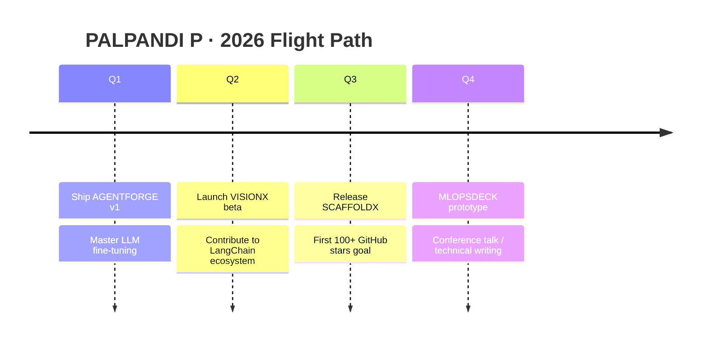

<div align="center">

<!-- ══════════════════════════════════════════════════════
     PALPANDI P — SIGNATURE EDITION README · DESIGN SYSTEM
     Palette: #00F5FF (Cyan) · #FF6B6B (Coral) · #0D1117 (Obsidian)
     Typeface: JetBrains Mono / Inter (via SVG-rendered systems)
     ══════════════════════════════════════════════════════ -->

<!-- ═══════════════ ① HERO — CYBER WAVE ═══════════════ -->


<!-- ═══════════════ ② SIGNATURE TYPOGRAPHY LOOP ═══════════════ -->
<a href="https://git.io/typing-svg"></a>

<br>

<!-- ═══════════════ ③ LIVE STATUS BADGES ═══════════════ -->
<a href="https://github.com/palpandi-p"></a>
<a href="https://github.com/palpandi-p?tab=repositories"></a>
<a href="https://github.com/palpandi-p"></a>

</div>

<br>

<!-- ═══════════════ ④ NEON DIVIDER ═══════════════ -->


---

##  &nbsp;IDENTITY CARD

<br>

<div align="center">
<table border="0">
<tr>
<td width="60%" valign="top">

```python
class PalpandiP:
    def __init__(self):
        self.name        = "PALPANDI P"
        self.location    = "India 🇮🇳"
        self.role        = "AI / ML Developer"
        self.edition     = "Signature"
        self.mission     = "Ship intelligent, production-grade AI systems"
        self.arsenal     = ["Python", "PyTorch", "FastAPI", "LLMs", "Docker", "AWS"]
        self.learning    = ["Agentic AI", "RAG Pipelines", "Model Optimization"]
        self.collab      = "Open Source · Python · NLP · AI Products"
        self.email       = "mr.palpandii@gmail.com"
        self.portfolio   = "portfolio-hh90vtlcc-palpandi-ps-projects.vercel.app"

    def greet(self):
        return "⚡ Building the future, one commit at a time."

p = PalpandiP()
print(p.greet())
```

</td>
<td width="40%" valign="top">

| 🛰️ TELEMETRY | VALUE |
|---|---|
| 🔭 Working on | AI-powered apps & automation |
| 🌱 Mastering | GenAI · LLMs · NLP |
| 🤝 Seeking | Model optimization & LLM integration |
| 💬 Ask me about | AI/ML development |
| ⚡ Fun fact | Ideas → Apps, one commit at a time |

</td>
</tr>
</table>
</div>

<br>

<div align="center">

<a href="https://linkedin.com/in/palpandii"></a>
<a href="https://instagram.com/pxlu.in"></a>
<a href="https://www.leetcode.com/palpandi-p"></a>
<a href="https://www.codechef.com/users/palu_coder"></a>
<a href="https://portfolio-hh90vtlcc-palpandi-ps-projects.vercel.app/"></a>
<a href="mailto:mr.palpandii@gmail.com"></a>

</div>

<br>

<!-- ═══════════════ ⑤ NEON DIVIDER ═══════════════ -->


---

##  &nbsp;MISSION CONTROL — LIVE METRICS

<div align="center">

<!-- Row 1: Core stats -->


<br><br>

<!-- Row 2: Languages + Repos -->


<br><br>

<!-- Row 3: Activity + Time -->


<br><br>

<!-- Full activity timeline -->


<br><br>

<!-- Trophy case -->


</div>

<br>

<!-- ═══════════════ ⑥ NEON DIVIDER ═══════════════ -->


---

##  &nbsp;ORBITAL VIEW — ACTIVITY GRAPHS

<div align="center">

<!-- Area commit graph -->


<br><br>

<!-- Snake animation (requires workflow — see notes) -->


<br>

<!-- 3D contribution calendar (auto-generated via workflow) -->


</div>

<br>

<!-- ═══════════════ ⑦ NEON DIVIDER ═══════════════ -->


---

##  &nbsp;TECH ARSENAL — ANIMATED BARS

<div align="center">

| DOMAIN | TECHNOLOGIES | PROFICIENCY |
|---|---|---|
| 🤖 AI / ML |     | `████████████████████` 95% |
| 🧠 LLM / NLP |    | `███████████████░░░░░` 78% |
| ⚙️ Backend |     | `████████████████░░░░` 85% |
| 🎨 Frontend |    | `██████████████░░░░░░` 72% |
| 🗄️ Data |    | `█████████████████░░░` 88% |
| ☁️ DevOps |     | `██████████████░░░░░░` 70% |

<br>

<!-- Animated icon wall -->


</div>

<br>

<!-- ═══════════════ ⑧ NEON DIVIDER ═══════════════ -->


---

##  &nbsp;LAUNCHPAD — FUTURE PROJECTS

<div align="center">

| 🚀 PROJECT | 🧬 DESCRIPTION | 🔧 STACK | 📌 PHASE |
|---|---|---|---|
| **AGENTFORGE** | Multi-agent orchestration framework — tool calling, memory, RAG | `LangChain` `FastAPI` `Redis` | 🟡 BUILDING |
| **VISIONX** | Real-time video intelligence — detection + tracking pipeline | `PyTorch` `OpenCV` `ONNX` | 🟡 BUILDING |
| **SCAFFOLDX** | One-command production API boilerplate — auth, rate-limit, logs | `NestJS` `Docker` `CI/CD` | 🔵 PLANNED |
| **NLPOWER** | Domain-adaptive NLP toolkit — fine-tune, eval & serve | `HF` `PyTorch` `vLLM` | 🔵 PLANNED |
| **MLOPSDECK** | Model serving dashboard — drift, latency & rollback control | `Grafana` `FastAPI` `AWS` | ⚪ VISION |

</div>

<br>

<div align="center">

### 🗺️ TRAJECTORY — 2026 ROADMAP



</div>

<br>

<!-- ═══════════════ ⑨ NEON DIVIDER ═══════════════ -->


---

##  &nbsp;TRANSMISSION — CONTACT & SUPPORT

<div align="center">

<a href="https://linkedin.com/in/palpandii"></a>
<a href="mailto:mr.palpandii@gmail.com"></a>
<a href="https://portfolio-hh90vtlcc-palpandi-ps-projects.vercel.app/"></a>

<br><br>


<br>

**⭐ Star my repos if they spark something — it fuels the next build.**


</div>
